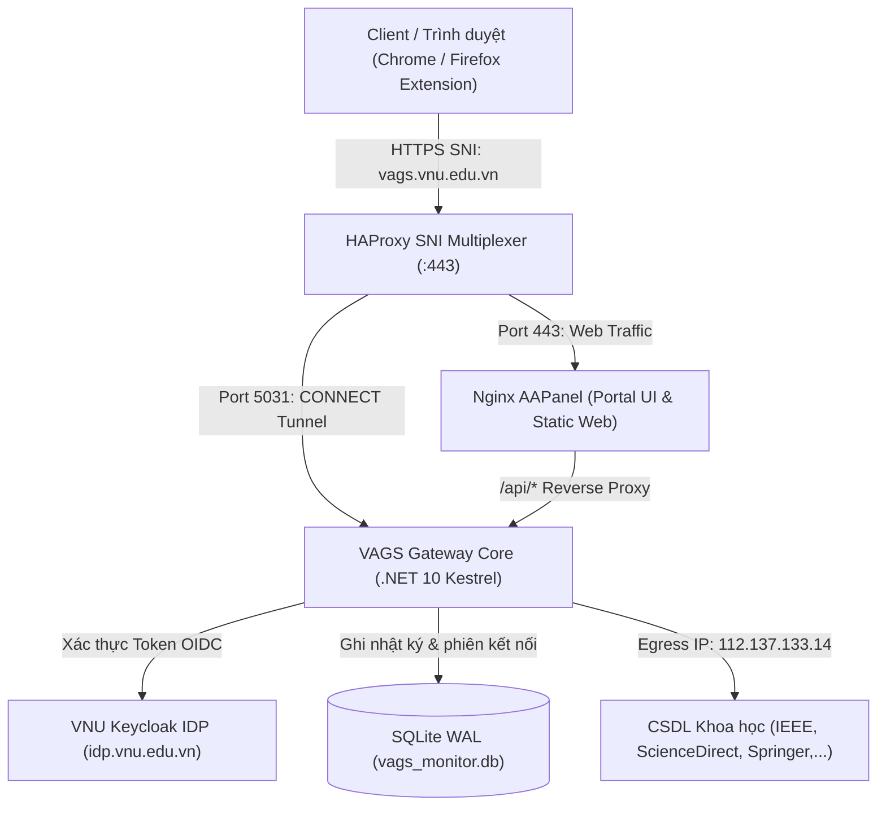

# VNU Academic Gateway (VAGS) 🎓🚀

> **Hệ thống Cổng Kết nối & Định tuyến CSDL Khoa học Quốc tế Đại học Quốc gia Hà Nội (ĐHQGHN)**  
> Cung cấp giải pháp truy cập từ xa an toàn, thông minh và tập trung vào các cơ sở dữ liệu học thuật quốc tế (ScienceDirect, IEEE Xplore, SpringerLink, Scopus, Nature,...) và Thư viện số ĐHQGHN (LIC).

---

## 🌟 Tính Năng Nổi Bật

- **Định Tuyến Thông Minh & Tự Động (Smart Proxy Routing)**:
  - Tự động nhận diện tài nguyên học thuật quốc tế và chuyển tiếp qua IP trường ĐHQGHN (`112.137.133.14`).
  - Mạng nội bộ `*.vnu.edu.vn` và các dịch vụ Google/Youtube đi trực tiếp (DIRECT), tối ưu băng thông máy chủ.
  - Phân cấp ưu tiên rõ ràng: *Tài khoản cá nhân $\rightarrow$ Danh sách cấm (Blacklist) $\rightarrow$ Thư viện LIC $\rightarrow$ Tên miền VNU $\rightarrow$ CSDL Khoa học $\rightarrow$ Chế độ mặc định*.
- **Đồng Bộ Tập Luật Thời Gian Thực (Real-Time SSE Sync)**:
  - Cập nhật quy tắc tên miền tức thời đến toàn bộ Browser Extension qua Server-Sent Events (`/api/v1/rules/stream`) mà không cần người dùng tải lại trang hay khởi động lại trình duyệt.
- **Tích Hợp Xác Thực Một Lần VNU SSO (Keycloak OIDC)**:
  - Đăng nhập tập trung qua hệ thống `https://idp.vnu.edu.vn`.
  - Phân quyền RBAC tự động theo Đơn vị công tác (`organizational_unit`), loại tài khoản (Cán bộ / Sinh viên / Quản trị viên).
- **Hệ Thống Phân Tích & Giám Sát Quản Trị (Admin Dashboard)**:
  - Giám sát lưu lượng, Top URL truy cập nhiều nhất, Top người dùng và Top IP theo thời gian thực.
  - Nhật ký kiểm toán chi tiết (Audit Logs) với tính năng tìm kiếm, bộ lọc đa chiều và xuất file CSV.
  - Quản lý khóa/mở khóa tài khoản, ép đăng xuất (Force Logout) hoặc cưỡng chế tắt Proxy khi phát hiện bất thường.
- **Giải Pháp Duy Nhất Cổng 443 (Port 443 Multiplexer)**:
  - Sử dụng HAProxy SNI Routing để chạy song song Web Portal HTTPS và HTTPS CONNECT Proxy trên cùng một cổng chuẩn `443`, không bị chặn bởi tường lửa doanh nghiệp/khách sạn.
- **Tiện Ích Trình Duyệt (Browser Extensions - Manifest V3)**:
  - Hỗ trợ đầy đủ Google Chrome, Microsoft Edge, Cốc Cốc, Brave và Mozilla Firefox.
  - Tự động cấu hình PAC Script (Proxy Auto-Config), hiển thị badge trạng thái kết nối và thanh điều khiển nhanh.

---

## 🏗 Kiến Trúc Hệ Thống



---

## 📁 Cấu Trúc Thư Mục

```text
├── backend/                  # Mã nguồn dịch vụ Gateway & API Core (.NET 10)
│   ├── Program.cs            # Khởi tạo Kestrel, Proxy Engine, SSE Stream, REST Endpoints
│   ├── MonitorDbService.cs   # Quản lý SQLite WAL, Active Sessions, Logs & Metrics
│   ├── VagsBackend.csproj    # File cấu hình dự án C#
│   └── Dockerfile            # Multi-stage Docker build
├── extension-chrome/         # Tiện ích mở rộng Chrome / Chromium (Manifest V3)
│   ├── background.js         # Service worker, Dynamic PAC engine, Auth provider
│   ├── content.js            # Floating UI badge & SSO bridge
│   ├── popup.html / popup.js # Giao diện popup điều khiển proxy & đăng nhập
│   └── manifest.json         # Chrome extension manifest
├── extension-firefox/        # Tiện ích mở rộng Mozilla Firefox (Manifest V3)
├── proxy/                    # Cấu hình HAProxy SNI Port 443 Multiplexer
│   └── haproxy.cfg
├── public/                   # Frontend Web & Assets
│   ├── index.html            # Cổng thông tin VAGS Portal & Hướng dẫn cài đặt
│   ├── admin.html            # VAGS Admin Management Console
│   ├── callback.html         # Trang chuyển tiếp OAuth2 SSO Callback
│   └── downloads/            # Gói cài đặt CRX, ZIP, XML cập nhật tự động
├── data/                     # Thư mục dữ liệu & Cấu hình tập luật
│   └── rules.json            # Whitelist/Blacklist và danh sách phân quyền
├── scripts/                  # Kịch bản tự động hóa & Kiểm thử
│   ├── run-phased-tests.sh   # Bộ kiểm thử tích hợp 5 giai đoạn
│   └── sni-port443-ctl.sh    # Script điều khiển HAProxy
├── docker-compose.yml        # Định nghĩa các dịch vụ Docker
└── .gitignore                # Danh mục loại trừ dữ liệu nhạy cảm
```

---

## 🚀 Hướng Dẫn Cài Đặt & Vận Hành

### 1. Yêu cầu Hệ thống
- Hệ điều hành: Linux (Ubuntu 22.04 LTS hoặc mới hơn khuyến nghị).
- Docker Engine & Docker Compose V2.
- Nginx hoặc Reverse Proxy hỗ trợ SSL/TLS.

### 2. Khởi chạy với Docker Compose
```bash
# 1. Clone repository
git clone https://github.com/vuongnguyen1/vnu_vags.git
cd vnu_vags

# 2. Khởi tạo và chạy các container ngầm
docker compose up -d --build

# 3. Kiểm tra trạng thái các container
docker compose ps
```

### 3. Kiểm Thử Hệ Thống Tự Động (5 Giai đoạn)
Hệ thống tích hợp sẵn kịch bản kiểm thử toàn diện từ hạ tầng, REST API, SSE, HTTPS CONNECT đến gói tải Extension:
```bash
chmod +x scripts/run-phased-tests.sh
./scripts/run-phased-tests.sh
```

---

## 🔒 Quản Trị & Bảo Mật

- **Mật khẩu ứng dụng (Proxy Access Key)**:
  Hỗ trợ sinh mật khẩu ứng dụng riêng cho từng Cán bộ để dùng trên thiết bị di động hoặc cấu hình thủ công qua PAC Script:
  `https://vags.vnu.edu.vn/vags.pac?user=<username>&key=<access_key>`
- **Bảo vệ dữ liệu riêng tư**:
  Các cơ sở dữ liệu nhật ký kết nối (`vags_monitor.db`), khóa ký số (`*.pem`) đều được cấu hình loại trừ tuyệt đối khỏi mã nguồn công khai qua `.gitignore`.

---

## 👥 Nhóm Phát Triển & Liên Hệ

* **Đơn vị vận hành**: Đại học Quốc gia Hà Nội (ĐHQGHN)
* **Email hỗ trợ**: `vuongwork@vnu.edu.vn`
* **Cổng dịch vụ**: [https://vags.vnu.edu.vn](https://vags.vnu.edu.vn)
* **Giao diện quản trị**: [https://vags.vnu.edu.vn/admin](https://vags.vnu.edu.vn/admin)
