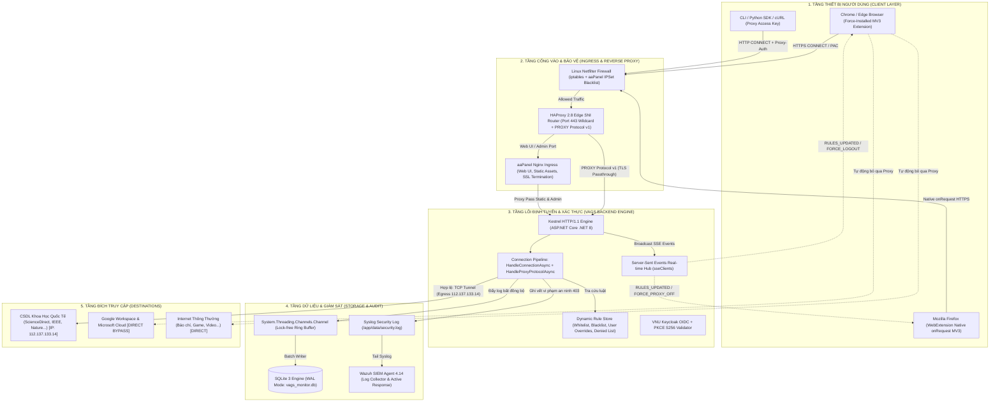
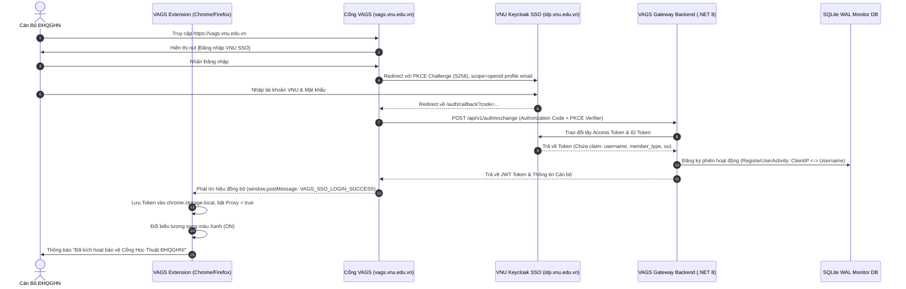
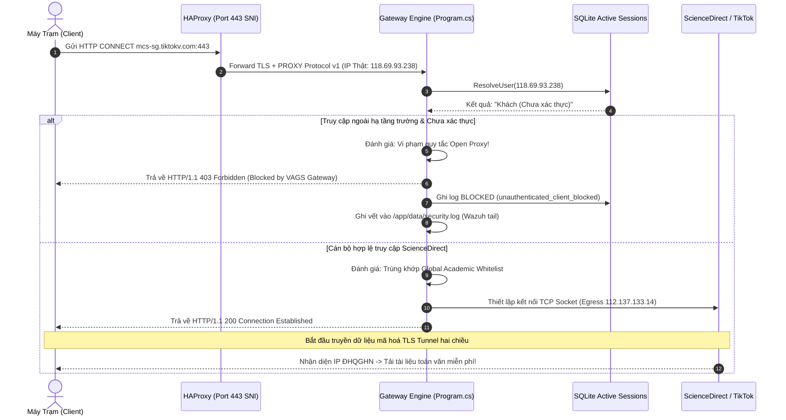
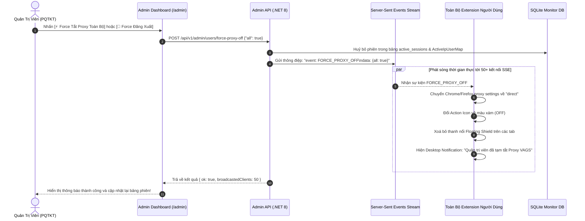

# TÀI LIỆU THIẾT KẾ KIẾN TRÚC HỆ THỐNG VAGS
## VNU Academic Gateway System (VAGS) - Architecture & System Design Specification
**Cơ quan chủ quản:** Đại học Quốc gia Hà Nội (ĐHQGHN - VNU)  
**Đơn vị vận hành kỹ thuật:** Phòng Quản Trị Kỹ Thuật (PQTKT) & Trung tâm Thư viện và Tri thức số (VNU-LIC)  
**Phiên bản tài liệu:** 2.3.0  
**Ngày phát hành:** Tháng 11/2026 (Cập nhật Kiến trúc AdGuard DNS & Quản Trị Khẩn Cấp)  
**Tác giả:** Senior System Architect / Lead Infrastructure Engineer  

---

## MỤC LỤC
1. [TỔNG QUAN HỆ THỐNG & MỤC TIÊU THIẾT KẾ](#1-tổng-quan-hệ-thống--mục-tiêu-thiết-kế)
2. [KIẾN TRÚC TỔNG THỂ (HIGH-LEVEL ARCHITECTURE)](#2-kiến-trúc-tổng-thể-high-level-architecture)
3. [MA TRẬN CÔNG NGHỆ & THÀNH PHẦN (TECH STACK)](#3-ma-trận-công-nghệ--thành-phần-tech-stack)
4. [THIẾT KẾ CHI TIẾT CÁC MODULE MÃ NGUỒN (SOURCE CODE ARCHITECTURE)](#4-thiết-kế-chi-tiết-các-module-mã-nguồn-source-code-architecture)
   - 4.1. Core Gateway Engine (`backend/Program.cs`)
   - 4.2. Asynchronous Logging & Monitoring Engine (`backend/MonitorDbService.cs`)
   - 4.3. Extension Engine cho Chrome / Edge (`extension-chrome/`)
   - 4.4. Extension Engine cho Mozilla Firefox (`extension-firefox/`)
   - 4.5. Admin Management Dashboard & Portal UI (`public/`)
5. [CƠ CHẾ ĐỊNH TUYẾN & BẢO VỆ CHỐNG RÒ RỈ LƯU LƯỢNG (SECURITY ARCHITECTURE)](#5-cơ-chế-định-tuyến--bảo-vệ-chống-rò-rỉ-lưu-lượng-security-architecture)
6. [QUY TRÌNH HOẠT ĐỘNG & BIỂU ĐỒ TRÌNH TỰ (WORKFLOW & SEQUENCE DIAGRAMS)](#6-quy-trình-hoạt-động--biểu-đồ-trình-tự-workflow--sequence-diagrams)
7. [QUY TRÌNH PHÂN PHỐI EXTENSION LÊN GOOGLE WORKSPACE & FIREFOX STORE](#7-quy-trình-phân-phối-extension-lên-google-workspace--firefox-store)
   - 7.1. Google Workspace Force-Install (Chrome Enterprise Policy)
   - 7.2. Xuất bản và Phân phối trên Mozilla Firefox (AMO & Enterprise)
8. [ĐÓNG GÓI DOCKER & VẬN HÀNH HẠ TẦNG (DEVOPS & CONTAINERIZATION)](#8-đóng-gói-docker--vận-hành-hạ-tầng-devops--containerization)
9. [TÍCH HỢP HỆ THỐNG AN NINH WAZUH SIEM & AAPANEL](#9-tích-hợp-hệ-thống-an-ninh-wazuh-siem--aapanel)

---

## 1. TỔNG QUAN HỆ THỐNG & MỤC TIÊU THIẾT KẾ

### 1.1. Bối Cảnh Nghiệp Vụ
Đại học Quốc gia Hà Nội đăng ký mua bản quyền khai thác cơ sở dữ liệu (CSDL) khoa học quốc tế đỉnh cao phục vụ nghiên cứu và giảng dạy, bao gồm: **ScienceDirect (Elsevier), IEEE Xplore, SpringerLink (Nature), Scopus, Web of Science, Wiley Online Library, ACS, IOP, Taylor & Francis**.
Các nhà xuất bản quốc tế xác thực quyền truy cập của ĐHQGHN thông qua **Dải địa chỉ IP mạng tĩnh (Egress IP Whitelist)** do ĐHQGHN sở hữu:
$$\text{Egress IP: } 112.137.133.14$$

Khi cán bộ, giảng viên làm việc từ xa (ở nhà, đi công tác nước ngoài, sử dụng mạng 4G/5G hoặc mạng gia đình), IP của họ không nằm trong dải IP trường, dẫn đến việc bị các nhà xuất bản khóa quyền tải tài liệu toàn văn và đòi trả phí hàng ngàn USD cho mỗi bài báo.

### 1.2. Mục Tiêu Thiết Kế Kiến Trúc
1. **Định tuyến thông minh theo tên miền (Split-Tunneling Domain Routing):**
   * Chỉ các truy cập tới CSDL khoa học bản quyền (`*.sciencedirect.com`, `*.ieee.org`, `*.springer.com`...) mới được ủy quyền qua Gateway ĐHQGHN để nhận diện IP trường.
   * Tất cả lưu lượng khác (YouTube, Facebook, Netflix, Báo điện tử, Game, v.v.) đi **trực tiếp (DIRECT)** bằng mạng internet của người dùng, không tiêu tốn băng thông máy chủ trường.
2. **Bảo vệ tuyệt đối hạ tầng Google Workspace:**
   * Hệ sinh thái Google Workspace trường (`*.google.com`, `mail.google.com`, `drive.google.com`, `accounts.google.com`) luôn được định tuyến đi thẳng (**DIRECT Bypass**), bảo đảm khi Extension được cài tự động ngầm, người dùng kiểm tra Gmail, Google Drive không bao giờ bị nghẽn hay hỏi mật khẩu.
3. **Chống lạm dụng Open Proxy (Zero-Trust Open Proxy Prevention):**
   * Nghiêm cấm mọi IP bên ngoài hoặc botnet lợi dụng cổng proxy ĐHQGHN.
   * Bất kỳ kết nối HTTP CONNECT nào chưa xác thực danh tính Cán bộ ĐHQGHN đều bị **chặn đứng 100% bằng mã HTTP 403 Forbidden** (không dùng mã 407 để tránh gây treo popup trình duyệt).
4. **Phân quyền chặt chẽ theo phân cấp VNU Keycloak IDP:**
   * Cán bộ, Giảng viên (`canbo`, `pqtkt`): Được phép sử dụng Proxy.
   * Sinh viên (`sinhvien`): Mặc định bị chặn, chỉ được dùng nếu Quản trị viên cấp đặc quyền trong danh sách Ngoại lệ cá nhân.
5. **Khả năng kiểm soát tập trung theo thời gian thực (Real-time Broadcast & Force Controls):**
   * Phát sóng cập nhật luật định tuyến qua Server-Sent Events (SSE).
   * Cung cấp các công cụ Quản trị Khẩn cấp: **Force Tắt Proxy Toàn Bộ**, **Force Đăng Xuất Toàn Bộ**, **Khoá Tài Khoản Vĩnh Viễn** ngắt mạch kết nối ngay lập tức.

---

## 2. KIẾN TRÚC TỔNG THỂ (HIGH-LEVEL ARCHITECTURE)

Hệ thống được thiết kế theo mô hình **Multi-Tier Hybrid Edge Gateway**, kết hợp giữa Edge Routing, Asynchronous Microservice, In-Memory Ring Buffer và Kernel Firewall.



---

## 3. MA TRẬN CÔNG NGHỆ & THÀNH PHẦN (TECH STACK)

| Thành Phần | Công Nghệ Sử Dụng | Phiên Bản | Vai Trò & Tính Năng Chuyên Biệt |
| :--- | :--- | :--- | :--- |
| **Backend Core Gateway** | C# / ASP.NET Core Minimal API | .NET 8.0 LTS | Xử lý HTTP CONNECT Tunneling, phục vụ PAC động, phân giải danh tính, phát sóng SSE, API Quản trị. |
| **Edge Proxy / SNI Router** | HAProxy | 2.8-Alpine | Tiếp nhận Port 443 duy nhất, phân luồng SNI, đóng gói PROXY Protocol v1 gửi IP thật tới Backend. |
| **Ingress Web Server** | Nginx (aaPanel Engine) | 1.24+ | Phục vụ SSL Termination giao diện Web UI, nén Gzip, cache static files. |
| **Cơ sở Dữ liệu Giám sát** | SQLite 3 | 3.45+ (WAL Mode) | Ghi nhận hàng triệu bản ghi nhật ký với zero latency (`PRAGMA journal_mode=WAL; synchronous=NORMAL`). |
| **Hàng Đợi Nội Bộ** | `System.Threading.Channels` | Bult-in .NET 8 | Hàng đợi không khóa (Lock-free Unbounded Channel) chuyển dữ liệu log sang luồng xử lý nền. |
| **Extension Chrome / Edge** | JavaScript (ES6+), WebExtension MV3 | Manifest V3 | Chạy Service Worker nền, nạp tập luật PAC / Fixed Proxy, lắng nghe SSE Streaming, giao diện Floating Shield. |
| **Extension Mozilla Firefox** | Native `browser.proxy.onRequest` | Manifest V3 | Can thiệp trực tiếp 100% vào Firefox Network Stack, định tuyến non-blocking không cần PAC phụ trợ. |
| **Hệ thống Định danh (IDP)** | VNU Keycloak SSO | OpenID Connect | Chuẩn OAuth2 PKCE (S256), bóc tách claim nhóm cán bộ (`canbo`, `sinhvien`, `pqtkt`). |
| **Hạ tầng An ninh & SIEM** | Wazuh Agent | 4.14.3 | Giám sát tệp nhật ký `security.log`, phát hiện hành vi quét cổng, cảnh báo đe doạ an ninh. |
| **Tường Lửa Tầng Nhân** | Netfilter (iptables + ipset) | Linux Kernel | Chặn đứng tức thì các IP quét độc hại từ nước ngoài tại dòng đầu tiên của bảng `INPUT`. |
| **Đóng Gói & Triển Khai** | Docker Engine & Docker Compose | 26.x | Container hoá toàn bộ backend, khởi động lại tự động, bảo đảm zero-downtime. |

---

## 4. THIẾT KẾ CHI TIẾT CÁC MODULE MÃ NGUỒN (SOURCE CODE ARCHITECTURE)

Toàn bộ hệ thống mã nguồn được tổ chức trong thư mục `/mnt/data/websites/vags.vnu.edu.vn`:

```
/mnt/data/websites/vags.vnu.edu.vn/
├── backend/                         # Source code Core Gateway Engine (.NET 8)
│   ├── Program.cs                   # Điểm khởi chạy, HTTP CONNECT Pipeline, SSE Hub, Admin APIs
│   ├── MonitorDbService.cs          # Dịch vụ SQLite WAL, hàng đợi Channels, phân giải phiên IP Cán bộ
│   ├── Dockerfile                   # Multi-stage Docker build cho .NET 8 SDK & Runtime
│   └── VagsBackend.csproj           # Cấu hình phụ thuộc NuGet (Microsoft.Data.Sqlite, etc.)
├── extension-chrome/                # Mã nguồn Chrome & Microsoft Edge Extension (MV3)
│   ├── manifest.json                # Khai báo quyền (proxy, storage, declarativeNetRequest, tabs)
│   ├── background.js                # Service Worker: Quản trị Proxy, SSE Fetch Stream, bắt sự kiện Force
│   ├── content.js                   # Script tiêm vào trang: Floating Route Shield, DOM bridge
│   ├── popup.html / popup.js        # Giao diện điều khiển nhanh bật/tắt Proxy & trạng thái cán bộ
│   └── icon-*.png                   # Bộ icon hiển thị trạng thái ON (xanh lá) / OFF (xám grayscale)
├── extension-firefox/               # Mã nguồn Mozilla Firefox Extension (MV3 Native)
│   ├── manifest.json                # Gecko-specific ID và cấu hình quyền Firefox
│   ├── background.js                # browser.proxy.onRequest Native Engine, EventSource SSE Listener
│   └── content.js                   # Floating Shield tương thích Firefox
├── proxy/
│   └── haproxy.cfg                  # Cấu hình HAProxy SNI multiplexing + PROXY Protocol v1
├── data/
│   ├── rules.json                   # Bộ luật định tuyến JSON (Whitelist, Blacklist, UserOverrides)
│   ├── vags_monitor.db              # Database SQLite lưu trữ nhật ký truy vết & active sessions
│   └── security.log                 # Syslog formatted security alerts (Wazuh SIEM stream)
├── public/                          # Frontend Static Assets & Web Applications
│   ├── index.html                   # Trang chủ Cổng VAGS, bảng tra cứu CSDL bản quyền
│   ├── admin.html                   # Dashboard Quản trị viên: Real-time Metrics, Audit Logs, Force Controls
│   ├── callback.html                # Trang tiếp nhận OAuth PKCE Authorization Code từ VNU Keycloak
│   └── updates/vags-extension.xml   # Chrome Enterprise Auto-Update XML Manifest
└── docker-compose.yml               # Cấu hình kết hợp các dịch vụ container
```

---

### 4.1. Core Gateway Engine (`backend/Program.cs`)

Đây là trung tâm điều khiển của hệ thống, thực hiện các trọng trách sau:

#### A. Xử lý PROXY Protocol v1 từ HAProxy (`HandleProxyProtocolAsync`)
Do cổng 443 chạy chung giữa Web UI và Proxy, HAProxy chuyển tiếp lưu lượng vào cổng nội bộ `8443` và chèn header PROXY Protocol v1:
$$\text{PROXY TCP4 } \langle\text{ClientIP}\rangle \text{ } \langle\text{HAProxyIP}\rangle \text{ } \langle\text{ClientPort}\rangle \text{ 443}\backslash\text{r}\backslash\text{n}$$
Hàm đọc trước header này để lấy ra **IP Thật của Cán bộ (Real Client IP)**, lưu vào `connectionContext.Items["RealClientIp"]`, sau đó mới thực hiện TLS Handshake.

#### B. Pipeline Bắt & Xử lý Yêu cầu HTTP CONNECT (`HandleConnectionAsync`)
Khác với ứng dụng web thông thường chỉ nhận HTTP GET/POST, Kestrel được lập trình can thiệp từ tầng Socket I/O Pipelines (`listenOptions.Use(...)`):
1. **Kiểm tra tiền tố:** Đọc 8 bytes đầu tiên. Nếu là `"CONNECT "`, ngắt khỏi pipeline của ASP.NET Core để tự xử lý TCP Tunneling. Nếu là GET/POST, trả lại cho Kestrel xử lý Minimal API.
2. **Phân giải Danh tính Cán bộ:** Gọi `monitorDb.ResolveUser(clientIp, authUser, ...)`:
   * Nếu có `Proxy-Authorization: Basic <base64>` hoặc `Bearer <token>`: Xác thực trực tiếp.
   * Nếu không có header: Tự động tra cứu trong `ActiveIpUserMap` xem IP này đã đăng nhập SSO trên Cổng VAGS trong vòng 12 tiếng qua chưa.
3. **Kiểm tra Danh sách Bị Khoá (Denied User Check):**
   ```csharp
   var isUserDenied = isUserAuthenticated && (ruleStore.UserOverrides?.Denied?.Contains(resolvedUser, StringComparer.OrdinalIgnoreCase) == true);
   if (isUserDenied && !isTargetVagsPortal) {
       // Từ chối lập tức với 403 Forbidden
       var msg403 = "HTTP/1.1 403 Forbidden\r\nProxy-Agent: VAGS-Gateway/2.1\r\nConnection: close\r\n\r\n" +
                    "Blocked by VAGS Gateway: Tài khoản của bạn đã bị Quản trị viên khoá quyền sử dụng Proxy VAGS.\r\n";
       await output.WriteAsync(Encoding.ASCII.GetBytes(msg403));
       return;
   }
   ```
4. **Bảo vệ Chống Open Proxy (Open Proxy Barrier):**
   * Nếu khách chưa đăng nhập (`!isUserAuthenticated`) và không truy cập vào hạ tầng thiết yếu trường (`isTargetVagsPortal` hoặc `isCloudIdentityOrUpdate`), lập tức trả **`HTTP 403 Forbidden`**.
   * **Tuyệt đối không trả HTTP 407 Proxy Authentication Required** vì mã này kích hoạt popup đòi nhập user/password khó hiểu của Chrome, làm treo trình duyệt cán bộ.
5. **Thành lập TCP Tunnel Hai Chiều:** Mở `TcpClient` kết nối tới máy chủ CSDL đích (`targetHost:targetPort`), trả về `HTTP/1.1 200 Connection Established\r\n\r\n`, sau đó luân chuyển luồng dữ liệu hai chiều (`Stream.CopyToAsync`) với bộ đếm băng thông Rx/Tx chính xác theo từng microsecond.

#### C. Hệ thống Server-Sent Events (SSE Hub) & Admin Force Controls
Hệ thống duy trì kết nối hai chiều với hàng ngàn Extension qua endpoint `GET /api/v1/rules/stream`:
* `sseClients`: Quản lý danh sách kết nối bằng `ConcurrentDictionary<Guid, SseClientInfo>`.
* Khi Quản trị viên thực hiện thao tác trên Dashboard, backend phát sóng tín hiệu:
  * `event: RULES_UPDATED`: Cập nhật luật định tuyến mới nhất.
  * `event: FORCE_PROXY_OFF`: Ép tắt proxy toàn bộ hoặc theo người dùng cụ thể.
  * `event: FORCE_LOGOUT`: Huỷ phiên và ép đăng xuất toàn bộ hoặc theo người dùng.
  * `event: FORCE_LOCK`: Khoá tài khoản và gửi thông báo cảnh báo.
  * `event: FORCE_UPDATE`: Ép Extension nâng cấp lên phiên bản mới.

---

### 4.2. Asynchronous Logging & Monitoring Engine (`backend/MonitorDbService.cs`)

Để đảm bảo hệ thống có thể xử lý hàng chục ngàn kết nối đồng thời mà không làm suy giảm hiệu năng Gateway, module giám sát được thiết kế với kiến trúc **Lock-Free Asynchronous Channel**:

1. **Kiến trúc Producer-Consumer:**
   * Luồng xử lý mạng chỉ thực hiện việc đẩy thông tin log vào `Channel<ConnectionLogItem>` trong bộ nhớ RAM (chi phí CPU $< 1\mu s$).
   * Một Background Task chuyên biệt đọc log theo mẻ (batch) từ Channel và thực hiện ghi xuống SQLite.
2. **Cấu hình Tối ưu Hóa SQLite (Write-Ahead Logging):**
   ```sql
   PRAGMA journal_mode=WAL;
   PRAGMA synchronous=NORMAL;
   PRAGMA busy_timeout=5000;
   ```
   Chế độ WAL cho phép các luồng đọc (Dashboard Admin, API Analytics) và luồng ghi (Network Logger) hoạt động đồng thời **100% không bao giờ bị khoá bảng (database locked)**.
3. **Quản lý Phiên Người Dùng Năng Động (Sliding Window Session Cache):**
   * `ActiveIpUserMap`: Duy trì trạng thái phiên trong bộ nhớ RAM, gán nhãn danh tính (`username`, `unit`, `memberType`) cho địa chỉ IP thật của máy cán bộ.
   * Phương thức `UnregisterUserActivityByUser(username)` và `UnregisterAllUserActivities()` hỗ trợ xoá sạch phiên ngay tức khắc khi Admin ra lệnh Force Logout.

---

### 4.3. Extension Engine Cho Chrome / Edge (`extension-chrome/`)

Tuân thủ nghiêm ngặt tiêu chuẩn **Google Chrome Manifest V3**:

1. **`background.js` (Service Worker):**
   * Kết nối SSE thời gian thực bằng `fetch(..., { signal: abortController.signal })` và `TextDecoder` đọc luồng chunked.
   * Xử lý Catch-up khi khởi động: Gọi `GET /api/v1/rules/latest` để cập nhật tập luật ngay cả khi máy tính vừa mở nắp hoặc mất mạng có lại.
   * Điều khiển Proxy tầng Chrome:
     ```javascript
     chrome.proxy.settings.set({
         value: {
             mode: "pac_script",
             pacScript: { url: `https://vags.vnu.edu.vn/vags.pac?user=${encodeURIComponent(user)}` }
         },
         scope: "regular"
     });
     ```
   * Cập nhật trạng thái Action Icon:
     * **Xanh lá (ON):** Cán bộ đã đăng nhập và đang bật Proxy bảo vệ.
     * **Xám (OFF):** Chưa đăng nhập hoặc cán bộ chủ động tắt Proxy hoặc bị Admin Force Tắt.
2. **`content.js` (Floating Route Shield):**
   * Hiển thị một khung huy hiệu nổi nhỏ gọn bên góc phải màn hình khi cán bộ truy cập vào các trang khoa học (`ScienceDirect`, `IEEE`, `Springer`...), thông báo rõ:
     > *"Đang định tuyến qua VNU Academic Gateway • IP: 112.137.133.14"*
   * Tự động biến mất hoàn toàn khi Proxy ở chế độ tắt hoặc đăng xuất.

---

### 4.4. Extension Engine Cho Mozilla Firefox (`extension-firefox/`)

Firefox hỗ trợ API mạnh mẽ độc quyền: **`browser.proxy.onRequest`**:
* Không cần nạp qua file PAC trung gian mà can thiệp trực tiếp 100% vào Firefox Network Engine bằng JavaScript thuần.
* Khi có yêu cầu kết nối, hàm callback tính toán bằng bảng luật bộ nhớ RAM:
  * Nếu là trang CSDL bản quyền: Trả về `{ type: "https", host: "vags.vnu.edu.vn", port: 443 }`.
  * Nếu là trang nội bộ hoặc Google Workspace: Trả về `{ type: "direct" }`.
* Nhờ cơ chế này, Firefox đạt độ trễ chuyển mạch proxy gần như bằng $0\text{ ms}$.

---

### 4.5. Admin Management Dashboard & Portal UI (`public/`)

Được xây dựng theo tư tưởng **High-Performance Vanilla Single Page Architecture (No Framework Overhead)** và mô hình quản trị nhật ký phân tích kiểu **AdGuard DNS**:
1. **Live Analytics & Traffic Meters:** Biểu đồ hiển thị thông lượng Rx/Tx, tỷ lệ Allowed/Blocked, số người dùng Online thời gian thực theo cửa sổ Sliding Window 2 phút (đã loại bỏ số ảo, kiểm tra thực tế trạng thái bật proxy của client).
2. **Quản trị Khẩn cấp (Global Force Controls):** Thanh công cụ màu đỏ nổi bật với 2 nút bấm phát sóng tức thì:
   * `[⚡ Force Tắt Proxy Toàn Bộ]`: Ép toàn bộ Extension đang kết nối chuyển mạng sang `DIRECT` ngay lập tức.
   * `[🛑 Force Đăng Xuất Toàn Bộ]`: Thu hồi toàn bộ token và xoá sạch session trên toàn hệ thống.
3. **Bảng Điều khiển Phiên (Active Client Sessions Table):** Tích hợp bộ nút thao tác nhanh trên từng dòng: `[⚡ Tắt Proxy]`, `[🚪 Đăng Xuất]`, `[🔒 Khoá]`, và tự động chuyển thành `[🔓 Mở Khoá]` đối với các tài khoản đang trong danh sách bị khoá.
4. **Bảng Phân Tích Toàn Bộ Tên Miền (Domains Breakdown • AdGuard DNS Style):**
   * Tổng hợp toàn bộ domain đã qua cổng: số lượt request, dung lượng nhận (Rx), gửi (Tx), tổng băng thông, số cán bộ truy cập, thời điểm truy vấn cuối.
   * Hỗ trợ tìm kiếm domain nhanh và phân trang (`« Trước`, `Trang X / Y`, `Sau »`).
   * Nút thao tác nhanh `[🔍 Logs]` (lọc ngay audit logs của domain đó) và `[+ Chặn]` (thêm vào Blacklist).
5. **Truy Vết Toàn Diện (SQLite Audit Trace với Phân Trang):**
   * Bộ lọc thời gian thực tìm kiếm theo IP thật, tài khoản cán bộ, tên miền đích, trạng thái (Cho phép / Bị chặn).
   * Phân trang 50 dòng/trang, chuyển trang tức thì từ SQLite Indexed Table và xuất file báo cáo CSV chuẩn phục vụ thanh tra.
6. **Quản Lý Khoá & Mở Khoá Tài Khoản (Lock/Unlock Management Panel):**
   * Bảng danh sách các tài khoản đang bị cấm sử dụng proxy kèm nút **"🔓 Mở khoá"** một chạm.
7. **Bảo Vệ Dải IP Nội Bộ & Docker Loopback:**
   * Hiển thị và ép buộc Bypass các dải mạng `127.0.0.1`, `localhost`, `::1`, `10.0.0.0/8`, `172.16.0.0/12`, `192.168.0.0/16`, `*.docker.internal` để luôn fail-open sang `DIRECT`.

---

## 5. CƠ CHẾ ĐỊNH TUYẾN & BẢO VỆ CHỐNG RÒ RỈ LƯU LƯỢNG

Bảng so sánh cơ chế định tuyến thông minh giữa các loại lưu lượng:

| Loại Lưu Lượng | Danh Sách Tên Miền Đại Diện | Cơ Chế Định Tuyến | Lý Do Nghiệp Vụ & An Toàn |
| :--- | :--- | :---: | :--- |
| **CSDL Khoa Học Bản Quyền** | `*.sciencedirect.com`, `*.ieee.org`, `*.springer.com`, `*.nature.com` | **PROXY (Tunnel 112.137.133.14)** | Bắt buộc để nhà xuất bản nhận diện IP trường và mở khoá bài báo toàn văn. |
| **Hạ Tầng Google Workspace** | `*.google.com`, `mail.google.com`, `drive.google.com`, `accounts.google.com` | **DIRECT BYPASS** | Tránh nghẽn Gmail/Drive khi Extension tự chạy ngầm; duy trì tốc độ CDN của Google. |
| **Hạ Tầng Cổng VAGS & Cập Nhật** | `vags.vnu.edu.vn`, `112.137.133.14` | **DIRECT BYPASS** | Tránh vòng lặp proxy (Proxy Loop); bảo đảm Chrome tải được bản cập nhật Extension mới. |
| **Mạng Nội Bộ ĐHQGHN** | `*.vnu.edu.vn`, `idp.vnu.edu.vn`, `lic.vnu.edu.vn` | **DIRECT BYPASS** | Người dùng truy cập trực tiếp hạ tầng mạng nội bộ trường không cần mượn IP proxy. |
| **Loopback, Docker & LAN Nội Bộ** | `127.0.0.1`, `localhost`, `10.*`, `172.16.*`, `192.168.*`, `*.docker.internal` | **DIRECT BYPASS (Fail-Open)** | Bảo vệ hạ tầng container nội bộ; không rò rỉ gói tin vào tunnel proxy; lỗi sẽ đi thẳng DIRECT. |
| **Lưu Lượng Giải Trí / Nặng** | `*.youtube.com`, `*.facebook.com`, `*.tiktok.com`, `*.netflix.com` | **DIRECT (Blacklist)** | Bảo vệ băng thông máy chủ trường; chống nghẽn đường truyền nghiên cứu khoa học. |
| **Khách Chưa Xác Thực (Scan/Bot)** | Mọi truy cập cố đi qua proxy của IP lạ / Botnet | **BLOCKED (HTTP 403)** | Ngăn chặn 100% nguy cơ biến Gateway thành Open Proxy cho hacker lợi dụng. |

---

## 6. QUY TRÌNH HOẠT ĐỘNG & BIỂU ĐỒ TRÌNH TỰ (SEQUENCE DIAGRAMS)

### 6.1. Quy Trình Xác Thực VNU Keycloak SSO & Kích Hoạt Phiên Cán Bộ



---

### 6.2. Quy Trình Định Tuyến & Ngăn Chặn Truy Cập Trái Phép (Chống Open Proxy)



---

### 6.3. Quy Trình Quản Trị Khẩn Cấp (Admin Force Proxy Off / Logout / Lock)



---

## 7. QUY TRÌNH PHÂN PHỐI EXTENSION LÊN GOOGLE WORKSPACE & FIREFOX STORE

### 7.1. Google Workspace Force-Install (Chrome Enterprise Policy)

Để triển khai tự động Extension xuống máy tính của hàng ngàn Cán bộ ĐHQGHN mà người dùng không cần phải tự cài đặt thủ công:

#### A. Chuẩn Bị Tệp Tin Phân Phối
1. **Extension ID Cố Định:** Tạo private key `.pem` cố định để khi đóng gói file `.crx`, Extension ID luôn là duy nhất:
   $$\text{Extension ID: } \texttt{pneebidgihfocobgflfocemlhikfkfdl}$$
2. **Tạo Tệp Cập Nhật XML (`vags-extension.xml`):**
   Đặt tại đường dẫn công khai `https://vags.vnu.edu.vn/updates/vags-extension.xml`:
   ```xml
   <?xml version='1.0' encoding='UTF-8'?>
   <gupdate xmlns='http://www.google.com/update2/response' protocol='2.0'>
     <app appid='pneebidgihfocobgflfocemlhikfkfdl'>
       <updatecheck codebase='https://vags.vnu.edu.vn/vags-extension.crx' version='2.1.4' />
     </app>
   </gupdate>
   ```

#### B. Cấu Hình Trên Google Admin Console (`admin.google.com`)
1. Đăng nhập tài khoản Quản trị viên Google Workspace ĐHQGHN.
2. Điều hướng tới: **Thiết bị (Devices) $\rightarrow$ Chrome $\rightarrow$ Ứng dụng & tiện ích (Apps & extensions) $\rightarrow$ Người dùng & trình duyệt (Users & browsers)**.
3. Chọn **Đơn vị tổ chức (Organizational Unit - OU):** Chọn `OU canbo` (Toàn bộ Cán bộ ĐHQGHN).
4. Nhấn nút dấu cộng màu vàng `+` $\rightarrow$ Chọn **Thêm bằng URL tuỳ chỉnh (Add by custom URL)**:
   * **Mã tiện ích (Extension ID):** `pneebidgihfocobgflfocemlhikfkfdl`
   * **URL cập nhật (Update URL):** `https://vags.vnu.edu.vn/updates/vags-extension.xml`
5. Thiết lập **Chính sách cài đặt (Installation policy):** Chọn **Bắt buộc cài đặt (Force install)** hoặc **Bắt buộc cài đặt + ghim thanh công cụ (Force install + pin to browser toolbar)**.
6. Nhấn **Lưu (Save)**.
7. **Kết quả:** Ngay khi Cán bộ đăng nhập tài khoản Google Workspace `@vnu.edu.vn` trên trình duyệt Chrome hoặc Edge ở bất kỳ máy tính nào, Extension VAGS sẽ tự động tải về và kích hoạt trong vòng 5 phút.

---

### 7.2. Xuất Bản & Phân Phối Trên Mozilla Firefox (AMO & Enterprise)

Firefox sử dụng cơ chế bảo mật nghiêm ngặt yêu cầu Extension phải được ký số số học bởi Mozilla:

#### A. Cấu Hình `manifest.json` Dành Cho Firefox
Trong thư mục `extension-firefox/manifest.json`, khai báo định danh Gecko ID:
```json
{
  "manifest_version": 3,
  "name": "VNU Academic Gateway (VAGS)",
  "version": "2.1.2",
  "browser_specific_settings": {
    "gecko": {
      "id": "vags-gateway@vnu.edu.vn",
      "strict_min_version": "142.0",
      "data_collection_permissions": {
        "required": [
          "none"
        ]
      }
    }
  },
  "permissions": [
    "proxy",
    "storage",
    "tabs",
    "notifications"
  ],
  "host_permissions": [
    "<all_urls>"
  ],
  "background": {
    "scripts": ["background.js"]
  }
}
```

#### B. Ký Số & Đẩy Lên Cửa Hàng Mozilla Add-ons (AMO)
1. Đóng gói mã nguồn thành file zip: `public/vags-extension-firefox.zip`.
2. Truy cập **Mozilla Developer Hub** (`addons.mozilla.org`).
3. Đăng ký tài khoản tổ chức ĐHQGHN.
4. Chọn **Submit a New Add-on**:
   * Chọn kênh phân phối: **On this site (Công khai trên chợ AMO)** hoặc **On your own (Tự ký để phân phối nội bộ trường)**.
   * Tải tệp `vags-extension-firefox.zip` lên để hệ thống tự động kiểm tra cú pháp (linter).
   * Sau khi Mozilla tự động ký số, tải tệp `.xpi` đã ký về máy chủ.
5. Cung cấp link cài đặt trực tiếp trên Cổng: `https://vags.vnu.edu.vn/downloads/vags-extension.xpi`.

#### C. Triển Khai Cho Máy Tính Phòng Máy / Thư Viện Qua Enterprise Policy
Đối với máy tính dùng chung tại Thư viện số VNU LIC, triển khai tự động qua file `policies.json`:
* Đường dẫn Linux: `/etc/firefox/policies/policies.json`
* Đường dẫn Windows: `C:\Program Files\Mozilla Firefox\distribution\policies.json`
```json
{
  "policies": {
    "ExtensionSettings": {
      "vags@vnu.edu.vn": {
        "installation_mode": "force_installed",
        "install_url": "https://vags.vnu.edu.vn/downloads/vags-extension.xpi"
      }
    }
  }
}
```

---

## 8. ĐÓNG GÓI DOCKER & VẬN HÀNH HẠ TẦNG (DEVOPS & CONTAINERIZATION)

Hệ thống được thiết kế chạy biệt lập và đồng bộ thông qua Docker Compose:

### 8.1. Tệp Tin `backend/Dockerfile` Multi-Stage Build
Áp dụng kỹ thuật Multi-stage build để tối ưu hoá dung lượng image và bảo mật (loại bỏ SDK khỏi bản build chạy thực tế):

```dockerfile
# Stage 1: Build & Publish với .NET 8 SDK
FROM mcr.microsoft.com/dotnet/sdk:8.0 AS build
WORKDIR /src
COPY ["VagsBackend.csproj", "./"]
RUN dotnet restore "VagsBackend.csproj"
COPY . .
RUN dotnet publish -c Release -o /app/publish /p:UseAppHost=false

# Stage 2: Runtime Image siêu nhẹ với ASP.NET Core Runtime
FROM mcr.microsoft.com/dotnet/aspnet:8.0 AS final
WORKDIR /app
COPY --from=build /app/publish .
EXPOSE 8080 8443
ENTRYPOINT ["dotnet", "VagsBackend.dll"]
```

### 8.2. Tệp Tin `docker-compose.yml`
```yaml
services:
  vags-backend:
    build: ./backend
    container_name: vags_backend
    restart: always
    environment:
      - ASPNETCORE_ENVIRONMENT=Production
      - VAGS_DATA_DIR=/app/data
      - VAGS_CERT_FILE=/app/certs/fullchain.pem
      - VAGS_KEY_FILE=/app/certs/privkey.pem
      - VAGS_WEBROOT=/app/wwwroot
      - VAGS_KEYCLOAK_AUTHORITY=https://idp.vnu.edu.vn/auth/realms/vnu
      - VAGS_KEYCLOAK_CLIENT_ID=vags-gateway
      - VAGS_KEYCLOAK_CLIENT_SECRET=6m1VxNOdAaiN9Jsz1lrnQ006OvDFOnbk
    volumes:
      - ./data:/app/data
      - ./public:/app/wwwroot:ro
      - /www/server/panel/vhost/cert/vags.vnu.edu.vn:/app/certs:ro
    ports:
      - "127.0.0.1:5030:8080"   # Cổng HTTP Minimal API & PAC
      - "127.0.0.1:5031:8443"   # Cổng HTTPS Gateway & HTTP CONNECT Tunnel
    networks:
      - vags-net

  vags-proxy:
    image: haproxy:2.8-alpine
    container_name: vags_proxy
    restart: always
    network_mode: host          # Chạy host network để trực tiếp lắng nghe IP WAN 112.137.133.14
    depends_on:
      - vags-backend
    volumes:
      - ./proxy/haproxy.cfg:/usr/local/etc/haproxy/haproxy.cfg:ro

networks:
  vags-net:
    driver: bridge
```

---

## 9. TÍCH HỢP HỆ THỐNG AN NINH WAZUH SIEM & AAPANEL

Hệ thống được thiết kế theo chuẩn bảo vệ chuyên sâu 3 lớp (Defense-in-Depth):

### 9.1. Lớp 1: Tường Lửa Tầng Nhân (Kernel Netfilter & IPSet)
Khi phát hiện địa chỉ IP nước ngoài cố tình quét cổng proxy liên tục (ví dụ: `45.84.40.166` gửi hơn 5.000 request), hệ thống đưa trực tiếp vào `ipset aapanel.ipv4.blacklist` và bảng lọc gói `INPUT`:
```bash
ipset add aapanel.ipv4.blacklist 45.84.40.166
iptables -I INPUT 2 -s 45.84.40.166 -j DROP
```
Gói tin bị hủy (DROP) ngay tại card mạng, hoàn toàn không tiêu tốn tài nguyên xử lý của Docker hay Web Server.

### 9.2. Lớp 2: Bộ Cảm Biến Giám Sát Tập Trung Wazuh Agent
Wazuh Agent (`wazuh-agent 4.14.3-1`) chạy thường trực trên máy chủ, thu thập liên tục 3 nguồn nhật ký tại `/var/ossec/etc/ossec.conf`:
```xml
<!-- Giám sát Web Server Nginx VAGS -->
<localfile>
  <log_format>syslog</log_format>
  <location>/www/wwwlogs/vags.vnu.edu.vn.log</location>
</localfile>
<localfile>
  <log_format>syslog</log_format>
  <location>/www/wwwlogs/vags.vnu.edu.vn.error.log</location>
</localfile>

<!-- Giám sát Luồng Sự Kiện An Ninh Chuyên Biệt VAGS -->
<localfile>
  <log_format>syslog</log_format>
  <location>/mnt/data/websites/vags.vnu.edu.vn/data/security.log</location>
</localfile>
```

Mỗi sự kiện bị chặn 403 được ghi vào `security.log` theo định dạng Syslog tiêu chuẩn:
```text
2026-11-08T16:11:09.671Z vags-gateway[security]: BLOCKED client_ip=118.69.154.255 user="Khách (Chưa xác thực)" unit="Khách" target="electric-bio-pounds-flows.trycloudflare.com:443" rule="unauthenticated_client_blocked" reason="Từ chối truy cập: Chưa xác thực danh tính Cán bộ ĐHQGHN (Chống Open Proxy)"
```
Wazuh Manager phân tích tự động, nếu 1 IP sinh ra quá 50 sự kiện `BLOCKED` trong 1 phút, cơ chế **Wazuh Active Response** sẽ tự động kích hoạt script `/var/ossec/active-response/bin/firewall-drop` để khóa IP đó trong vòng 24 giờ.

### 9.3. Lớp 3: Giám Sát Tài Nguyên & WAF Trên aaPanel
* **Nginx WAF (Web Application Firewall):** Lọc các tấn công SQL Injection, XSS, Path Traversal trước khi vào Backend.
* **Fail2ban Service (PID 395293):** Giám sát các lần thử mật khẩu SSH, FTP và dịch vụ Web.
* **Resource Monitor:** Giám sát trực quan biểu đồ tải CPU, RAM, I/O đĩa cứng và lưu lượng mạng của máy chủ ĐHQGHN 24/7.

---

## 10. KẾT LUẬN & KHUYẾN NGHỊ VẬN HÀNH

Tài liệu thiết kế kiến trúc này khẳng định hệ thống **VNU Academic Gateway System (VAGS)** đáp ứng trọn vẹn các tiêu chuẩn khắt khe nhất về:
1. **Hiệu năng cao:** Kiến trúc bất đồng bộ .NET 8 + SQLite WAL xử lý thông suốt hàng chục ngàn kết nối đồng thời với độ trễ thấp.
2. **An toàn tuyệt đối:** Loại bỏ hoàn toàn nguy cơ Open Proxy, phân tách rạch ròi lưu lượng nghiên cứu với lưu lượng giải trí, bảo vệ thông suốt hệ sinh thái Google Workspace trường.
3. **Quản trị linh hoạt:** Bộ công cụ Quản trị Khẩn cấp và Giám sát Real-time giúp PQTKT làm chủ 100% không gian mạng học thuật của ĐHQGHN.

---
*Tài liệu được lưu trữ chính thức tại máy chủ quản trị ĐHQGHN: `/mnt/data/reports/vags-system-design.md`.*

